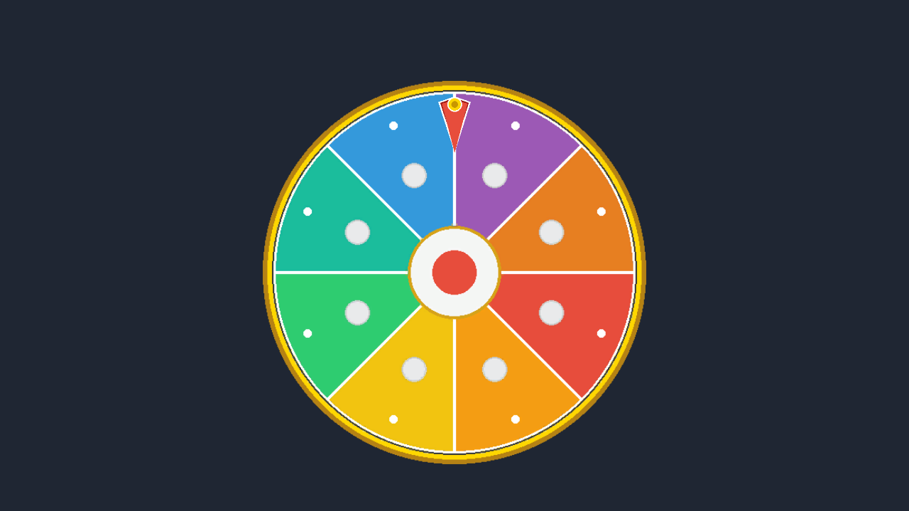

# 1151VR-HW3-414262272-LCH

## 一、專案截圖

### 1. 圖片1

### 圖片2

---

## 二、GitHub 連結

- **GitHub Repository**: https://github.com/Johnson-bro-coder/1151VR-HW3-414262272-LCH

---

## 三、YouTube 連結

- **YouTube 演示影片**: https://youtu.be/mvz4aNupcNo

---

## 四、說明製作流程和相關操作

### 1. Unity 2D 專案建置與資源匯入
- **專案架構**：使用 Unity 2D 模板建立專案。
- **Sprite 載入**：
  - 輪盤圖片
  - 指針圖片
- **音效載入**：
  - 跳格音效：指針滑過每個扇形區塊時觸發的俐落點擊聲。
  - 停止結算音效：輪盤完全靜止時播放的勝利提示和弦。

### 2. 輪盤加速旋轉後減速停止核心邏輯
- **階段一：點擊啟動**
  - 偵測玩家輸入。
  - 若輪盤處於靜止狀態，隨機產生目標最高轉速，保證每次旋轉結果皆不相同。
- **階段二：平滑加速**
  - 每幀以定額加速度遞增速度
  - 當到達目標最高速時，自動切換至減速階段。
- **階段三：阻尼減速**
- **階段四：完全停止**
  - 當速度小於門檻值時，將速度歸零並判定停止，觸發結算音效。

### 3. 加載音效至物件中 

### 4. 手機裝置支援與輸出測試
- **觸控相容性**：
  在 Unity 內部機制中，手機單指 Tap 會自動對應到滑鼠第 0 號鍵

- **導出手機平台測試**：
  可在 Unity 的 `File -> Build Settings` 中將 Platform 切換為 **iOS** 或 **Android** 進行輸出與安裝測試。
